# Texto recuperado de imágenes incrustadas en Excel

Las imágenes EMF se leen a través de sus registros de texto; las imágenes raster mediante OCR. El orden y los símbolos de las ecuaciones pueden ser imperfectos. Los hashes deduplican la misma imagen entre plantilla y solución.

## Imagen 7164d3778886

Fuentes: `XLS-001` / `xl/media/image1.emf`

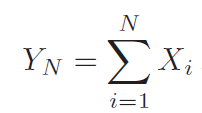

N
Yy =o Xi
i=l

## Imagen 1c079d364388

Fuentes: `XLS-003` / `xl/media/image1.png`, `XLS-007` / `xl/media/image1.png`

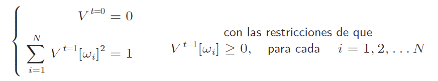

yi _9¢9
N con las restricciones de que
» Vey? = 1 Vvit[w)] >0, paracada i=1,2,...N
i=l

## Imagen 6d0c4b5e695f

Fuentes: `XLS-003` / `xl/media/image4.emf`, `XLS-007` / `xl/media/image5.emf`

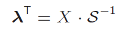

ou
=X
-S”
1

## Imagen d8389d308136

Fuentes: `XLS-003` / `xl/media/image2.emf`, `XLS-007` / `xl/media/image3.emf`

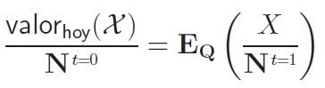

X )
1
= Be (s
lorhoy
= t=0
N

## Imagen 70498f9f54e1

Fuentes: `XLS-003` / `xl/media/image3.emf`, `XLS-007` / `xl/media/image4.emf`

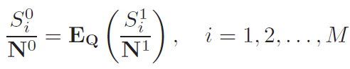

99 gt
No = Fa (=): PS h Ml

## Imagen 1a664e483549

Fuentes: `XLS-004` / `xl/media/image1.emf`

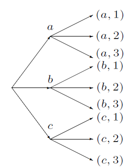

(a, 1)
a

(a,2)

(a, 3)

(b 1)
b (6,2)

(b,3)

(1)
Cc

(6,2)

(c.3)

## Imagen 68b91cecee2c

Fuentes: `XLS-005` / `xl/media/image1.emf`, `XLS-006` / `xl/media/image1.emf`

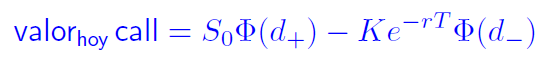

valorhoy call = Sp@(d4) — Ke7"? ®(d_)

## Imagen f67a0252f523

Fuentes: `XLS-005` / `xl/media/image2.emf`, `XLS-006` / `xl/media/image2.emf`

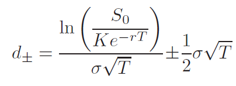

So )
(wet) (mt 41 o VT
de = oVT 2

## Imagen bad921417b3b

Fuentes: `XLS-005` / `xl/media/image3.emf`, `XLS-006` / `xl/media/image3.emf`

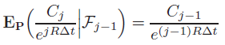

Br(F1) =e

## Imagen c0a7fd811c52

Fuentes: `XLS-005` / `xl/media/image4.png`

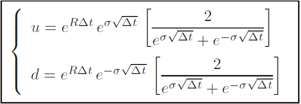

a eRAt govt | 2
coVAl 4 p-oVat
d= eRAt eo VAt 2
coVAl 4 g-aVAt

## Imagen 01ff63e88f69

Fuentes: `XLS-007` / `xl/media/image2.emf`

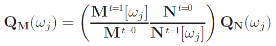

Quite) = (AAS) antes

## Imagen 765f7be780f8

Fuentes: `XLS-008` / `xl/media/image1.emf`

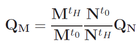

M'# Nio

## Imagen f2f67ed03660

Fuentes: `XLS-009` / `xl/media/image1.emf`

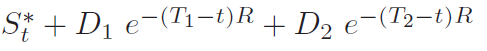

S*+ Dy e~-
4 Dy e(Mi-9R 4 Dy e~ (2-H BR

## Imagen 969810354fc1

Fuentes: `XLS-009` / `xl/media/image2.emf`

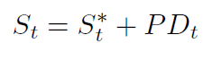

S, = S*+ PD,

## Imagen bd8844d0e3f2

Fuentes: `XLS-009` / `xl/media/image3.emf`

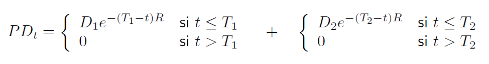

PD, = Dye“M1-HF sit <Ty 4 Dye (P2-9F sit <7,
0 sit >T, 0 sit > T>

## Imagen 254b66de1faf

Fuentes: `XLS-010` / `xl/media/image1.emf`

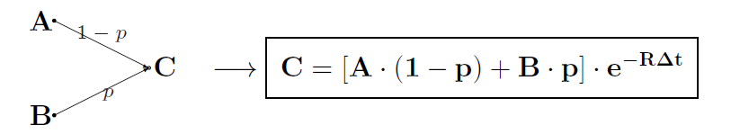

AN —p
Se —|C=[A-(1—p)+B-p]-eB®*
B

## Imagen 3d95009113c7

Fuentes: `XLS-011` / `xl/media/image1.emf`

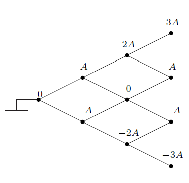

3A
2A
<< t
0
— -A
-3A

## Imagen 5845caa698b8

Fuentes: `XLS-011` / `xl/media/image2.emf`

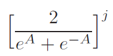

2 j
eA al

## Imagen 87ee6428f14e

Fuentes: `XLS-011` / `xl/media/image3.emf`

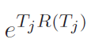

eTiR(T))

## Imagen 9340b0b6bb84

Fuentes: `XLS-011` / `xl/media/image4.emf`

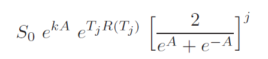

So eA TRC) —_ j
eA + =a

## Imagen cfa9bedc18a1

Fuentes: `XLS-012` / `xl/media/image1.emf`

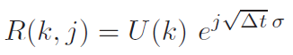

R(k,j) = U(k) elVAt2

## Imagen ab4016ea35b6

Fuentes: `XLS-013` / `xl/media/image1.jpeg`, `XLS-014` / `xl/media/image1.jpeg`, `XLS-015` / `xl/media/image1.jpeg`, `XLS-016` / `xl/media/image1.jpeg`, `XLS-017` / `xl/media/image1.jpeg`, `XLS-023` / `xl/media/image1.jpeg`, `XLS-024` / `xl/media/image1.jpeg`, `XLS-025` / `xl/media/image1.jpeg`, `XLS-026` / `xl/media/image1.jpeg`, `XLS-027` / `xl/media/image1.jpeg`, `XLS-028` / `xl/media/image1.jpeg`, `XLS-029` / `xl/media/image1.jpeg`, `XLS-037` / `xl/media/image1.jpeg`, `XLS-038` / `xl/media/image1.jpeg`, `XLS-039` / `xl/media/image1.jpeg`, `XLS-041` / `xl/media/image1.jpeg`, `XLS-042` / `xl/media/image1.jpeg`

» ; :

## Imagen c56a25361ee5

Fuentes: `XLS-013` / `xl/media/image3.png`

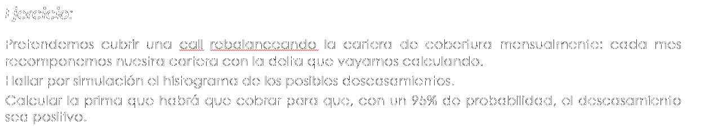

Ejercicio:

Pretendemos cubrir una call rebalanceando la cartera de cobertura mensualmente: cada mes
recomponemos nuestra cartera con la delta que vayamos calculando.

Hallar por simulacién el histograma de los posibles descasamientos.

Calcular la prima que habrd que cobrar para que, con un 95% de probabilidad, el descasamiento
sea positivo.

## Imagen 227f5c5c6de5

Fuentes: `XLS-013` / `xl/media/image2.emf`, `XLS-018` / `xl/media/image1.emf`

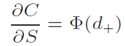

oC
— = &(d
ag = (4+)

## Imagen 03ed17e2629f

Fuentes: `XLS-014` / `xl/media/image2.emf`, `XLS-019` / `xl/media/image1.emf`

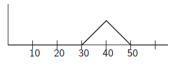

‘$0 Ly 4

## Imagen d84981decc50

Fuentes: `XLS-014` / `xl/media/image3.png`, `XLS-019` / `xl/media/image2.png`

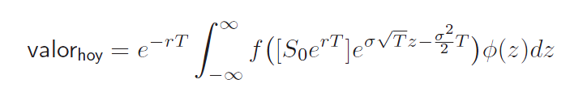

00 2
valorhoy = an | f ([Soe" ]e?YT*- 27) O(z)dz

## Imagen 5945a0d53a6f

Fuentes: `XLS-016` / `xl/media/image4.emf`

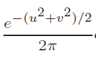

en (utv)/2
Qr '

## Imagen 4f320645217d

Fuentes: `XLS-016` / `xl/media/image2.emf`, `XLS-021` / `xl/media/image1.emf`

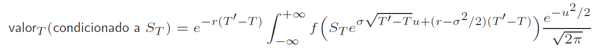

2
y +00 7 2 / ev /2
| dicionado a S: —r(T mf g oVT!—-Tut(r—0*/2)(T'-T)
valorp(condicionado a Sp) = e - F( Te SF

## Imagen a96c6d1b96ab

Fuentes: `XLS-016` / `xl/media/image3.emf`

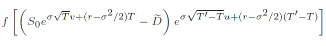

o 'U- roo rt
f [ (soe VP v+(r—07/2)T _ D) VTP oa)

## Imagen c8d337fe0dc1

Fuentes: `XLS-017` / `xl/media/image6.png`

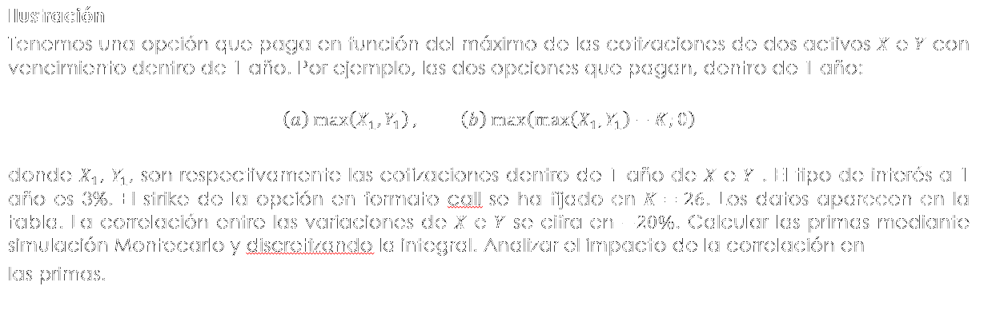

llustracién

Tenemos una opcidén que paga en funcién del maximo de las cotizaciones de dos activos X¥ e Y con
vencimiento dentro de 1 afo. Por ejemplo, las dos opciones que pagan, dentro de | afo:

(a) max(X1,%), (b) max(max(X,, %) — K; 0)

donde Xj, ¥,, son respectivamente las cotizaciones dentro de 1 afo de X eY . El tipo de interés a 1
afio es 3%. El strike de la opcién en formato call se ha fijado en K = 26. Los datos aparecen en la
tabla. La correlacién entre las variaciones de X e Y se cifra en —20%. Calcular las primas mediante
simulacién Montecarlo y discretizando la integral. Analizar el impacto de la correlacién en

las primas.

## Imagen 5f21e1cc2937

Fuentes: `XLS-017` / `xl/media/image4.emf`, `XLS-022` / `xl/media/image3.emf`

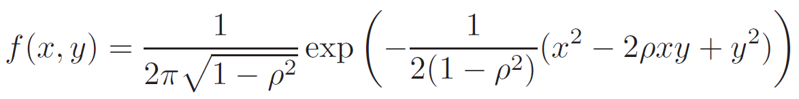

~— 1, (-— + 4? 2

## Imagen ea795fadce46

Fuentes: `XLS-017` / `xl/media/image5.emf`, `XLS-022` / `xl/media/image4.emf`

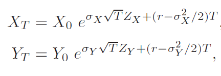

Xp =Xo eOxVTZx (7-0 /2)T
Yr =Yo cov VT Ly +(r—-0y-/2)T

## Imagen 0193f77f26fc

Fuentes: `XLS-017` / `xl/media/image2.emf`, `XLS-022` / `xl/media/image1.emf`

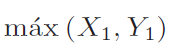

max (X1, Y1)

## Imagen e8fb79569bbe

Fuentes: `XLS-017` / `xl/media/image3.emf`, `XLS-022` / `xl/media/image2.emf`

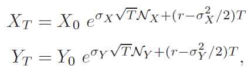

Xr _ Xo eIxVINX+(0—0% /2)T
Yr _ Yo ery VINY +(r—o4-/2)T

## Imagen 33e46808195d

Fuentes: `XLS-020` / `xl/media/image1.png`

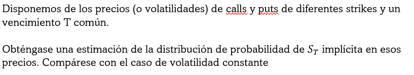

Disponemos de los precios (0 volatilidades) de calls y puts de diferentes strikes y un
vencimiento T comun.

Obténgase una estimacion de la distribucion de probabilidad de S; implicita en esos
precios. Comparese con el caso de volatilidad constante

## Imagen 13a28ad62301

Fuentes: `XLS-022` / `xl/media/image5.png`

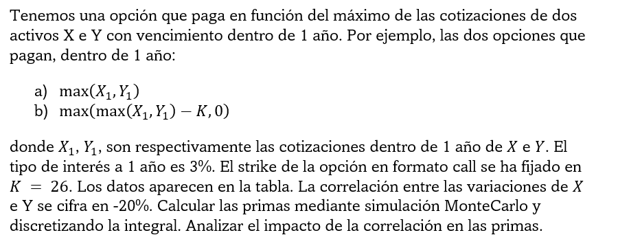

Tenemos una opcidn que paga en funcién del maximo de las cotizaciones de dos
activos X e Y con vencimiento dentro de 1 afio. Por ejemplo, las dos opciones que
pagan, dentro de 1 afio:

a) max(X,,%4)

b) max(max(X;, Y,) — K,0)
donde X;,, Y,, son respectivamente las cotizaciones dentro de 1 afio de X e Y. El
tipo de interés a 1 afio es 3%. El strike de la opcion en formato call se ha fijado en
K = 26. Los datos aparecen en la tabla. La correlacién entre las variaciones de X
e Y se cifra en -20%. Calcular las primas mediante simulacion MonteCarlo y
discretizando la integral. Analizar el impacto de la correlacion en las primas.

## Imagen 3c0dad3b5127

Fuentes: `XLS-024` / `xl/media/image2.emf`, `XLS-025` / `xl/media/image6.emf`, `XLS-031` / `xl/media/image1.emf`, `XLS-033` / `xl/media/image5.emf`

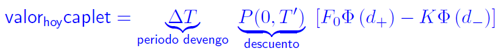

) [Fo® (d,.) — K® (d_)]
valornoycaplet = aw . on [Fo® (d+
periodo devengo lescuento

## Imagen 57712f17f854

Fuentes: `XLS-024` / `xl/media/image5.emf`, `XLS-031` / `xl/media/image4.emf`

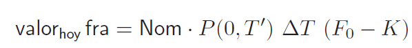

valorhey fra = Nom - P(0,7”) AT (Fp — K)

## Imagen 6db0849da6fe

Fuentes: `XLS-024` / `xl/media/image3.emf`, `XLS-025` / `xl/media/image7.emf`, `XLS-031` / `xl/media/image2.emf`, `XLS-033` / `xl/media/image6.emf`

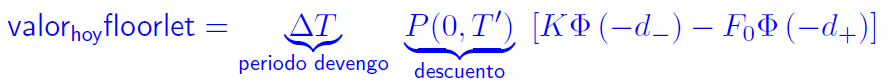

") [K® (—d_) — Fy (—d4)]
valorhoyfloorlet = a . ce" [EK ® (
periodo devengo lescuento

## Imagen c20745d29cc7

Fuentes: `XLS-024` / `xl/media/image4.emf`, `XLS-031` / `xl/media/image3.emf`

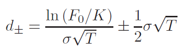

n(F/K) 1g
dy = 5

## Imagen c3d23bbc09d6

Fuentes: `XLS-025` / `xl/media/image4.emf`, `XLS-033` / `xl/media/image3.emf`

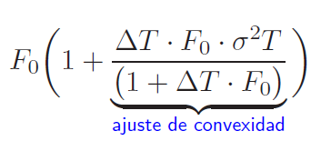

. 2
F(14 AT. Fy -o°T
(1+ AT- Fo)
SSE
ajuste de convexidad

## Imagen bced12dae616

Fuentes: `XLS-025` / `xl/media/image5.emf`, `XLS-033` / `xl/media/image4.emf`

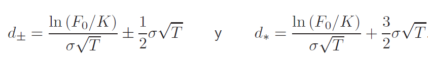

VT In(Fo/K) 3 oF
In(Fo/) | 1) Ty de = et 5
(2=—E *3

## Imagen 980dbc4c8d69

Fuentes: `XLS-025` / `xl/media/image2.emf`, `XLS-033` / `xl/media/image1.emf`

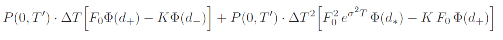

P(0,T')- AT [Fo(dy) - Ko(d_)] + P(0,T’)- AT? [Fi ce? T O(d,) — K Fo o(d,)|

## Imagen 46c8209d9ee6

Fuentes: `XLS-025` / `xl/media/image3.emf`, `XLS-033` / `xl/media/image2.emf`

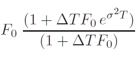

(L+ATFye” 7)
Fo uo"
(1+ ATF)

## Imagen 4c7c9800af71

Fuentes: `XLS-026` / `xl/media/image3.emf`, `XLS-034` / `xl/media/image2.emf`

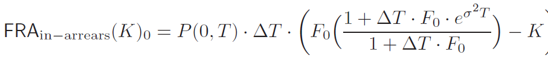

2)
L4AT-Fy-et ty)
FRAin—arvoars(K)o = P(0,T)- AT (W(t) _K

## Imagen ac910ae95176

Fuentes: `XLS-026` / `xl/media/image2.emf`, `XLS-034` / `xl/media/image1.emf`

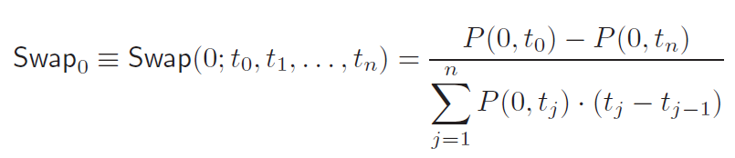

Swapp = S
= Swap(0; t
o.ti,...,tn) = —P0.to) = PO tn)
So P(0,t3) + (t;
aq i) (tj; — t7-1)

## Imagen c401f5a088ec

Fuentes: `XLS-028` / `xl/media/image2.emf`, `XLS-036` / `xl/media/image1.emf`

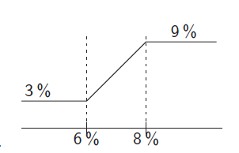

; 9%
6% 8%

## Imagen 59a9fb04d1a4

Fuentes: `XLS-029` / `xl/media/image3.emf`, `XLS-032` / `xl/media/image2.emf`

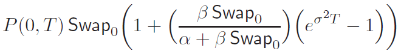

P(0,T) Swapp (: 4 (SS) (e"" _ :))

## Imagen 9a7fed731783

Fuentes: `XLS-029` / `xl/media/image2.emf`, `XLS-032` / `xl/media/image1.emf`

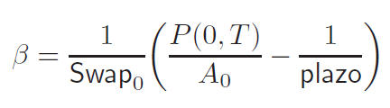

ge (POT) 1
~ Swapp\ Ao _ plazo

## Imagen 3f51e7827c23

Fuentes: `XLS-037` / `xl/media/image2.emf`, `XLS-045` / `xl/media/image1.emf`

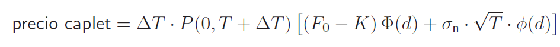

precio caplet = AT - P(0,T + AT) [(Fo — K) ®(d) + on- VT - o(d)]

## Imagen 1605e09b4d44

Fuentes: `XLS-037` / `xl/media/image3.emf`, `XLS-045` / `xl/media/image2.emf`

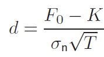

york
~ onVT

## Imagen 16d9759dc985

Fuentes: `XLS-037` / `xl/media/image4.emf`, `XLS-045` / `xl/media/image3.emf`

precio caplet = AT - P(0,T + AT) [(Fo + sh) ®(d4) — (K + sh) ®(d_)]
con In((Ep + sh)/(K + sh)) . 1
n 0 Ss Ss
ds. = St ron.
* onVT 2°

## Imagen 966788c9f8c3

Fuentes: `XLS-038` / `xl/media/image3.emf`, `XLS-046` / `xl/media/image2.emf`

precio caplet = AT - P(0,T + AT) [(Fo — K) ®(d) + on - VT - o(d)],
donde ® y @ son, respectivamente, la funcién de distribucién y la funcién de densidad
de la normal estandar, y donde
d= Fyo-K
 onWVT

## Imagen 5ac71bf0a6a4

Fuentes: `XLS-038` / `xl/media/image2.emf`, `XLS-046` / `xl/media/image1.emf`

caplet = AT - P(0,T + AT) [(Fo + sh)@(d,) — (Xv + sh) &(d_)],
—_ In((Fo +sh)/(K +sh)) | 1
dz, = a, ca + 50vT.

## Imagen 3c4d0e26ff87

Fuentes: `XLS-039` / `xl/media/image2.emf`, `XLS-047` / `xl/media/image1.emf`

Fy +sh = (Fy + sh) e779 /2 %m Viz

## Imagen 83acf8c21ea7

Fuentes: `XLS-041` / `xl/media/image2.emf`, `XLS-044` / `xl/media/image1.emf`

1s yr AT - P(0,t; + AT) - L(0, ti, ti + AT)
9 = So BEE Ee
Ao

## Imagen 859b0a21abf8

Fuentes: `XLS-042` / `xl/media/image5.emf`, `XLS-048` / `xl/media/image4.emf`

valor (en €UrOS) hoy forward = Ry-(0, 7) (FX gwa(0) - K) - [1A ddlares]

## Imagen 2b439c023312

Fuentes: `XLS-042` / `xl/media/image3.emf`, `XLS-048` / `xl/media/image2.emf`

valor (en CULOS hoy call = Ru (0, T) (FX fwa(0) O(d,)-K ®(d_)) - [LM délares]

## Imagen f89710dbcbff

Fuentes: `XLS-042` / `xl/media/image2.emf`, `XLS-048` / `xl/media/image1.emf`

EX fwa(T) = FX jug(0) ewP 7/2 ee VT

## Imagen a6216e1da430

Fuentes: `XLS-042` / `xl/media/image4.emf`, `XLS-048` / `xl/media/image3.emf`

In (Pee) 1
dz = 7, + 50vT
