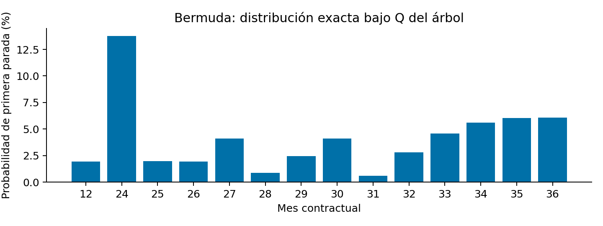
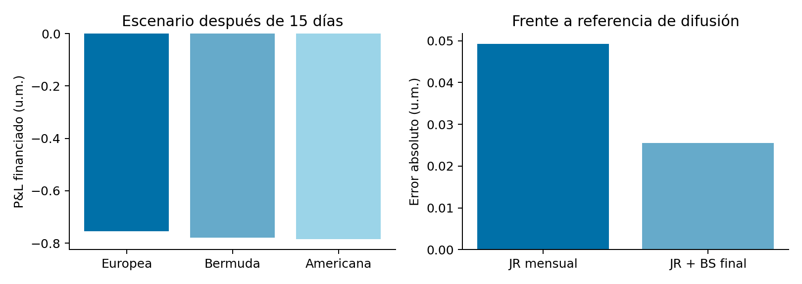

# Alcance, fuentes y lectura

Esta memoria contiene **derivaciones y cálculos nuevos**, no soluciones docentes transcritas. La autoridad contractual es PDF-002, *Valoración MEFC 2026*, pp.1–4; el desarrollo de E3 corresponde a las 25 diapositivas de PPT-001; PDF-001 fija entrega y defensa. Los originales están intactos en `raw/encargo/`. Las referencias a páginas son físicas del PDF. Las fichas de `knowledge-base/` son interpretación documental, no una fuente sustitutiva ni resultados recalculados.

Se han leído completos los tres documentos vinculantes y sus extracciones. Se han inspeccionado los originales renderizados, especialmente las ecuaciones de PPT-001 y PDF-003 pp.24–25 y la mejora de PDF-006 pp.51–53. El extra de cesta de +1 punto (PDF-002 p.4) queda opcional pendiente; sí se incluye la call usual de +0,5 de PPT-001 diap.25. E2 y E3 son encargos teóricos sin un juego de parámetros numéricos; sus ejemplos de control están rotulados como ilustrativos.

La matriz de cumplimiento está en `MATRIZ_CUMPLIMIENTO.md`. El código de referencia está en `src/`, las evidencias en `resultados/` y las hojas identificadas por ejercicio en `hojas/`. La memoria es el documento canónico; los JSON conservan más decimales que las tablas. Para defender la solución conviene reconstruir primero cada contrato, elegir su numerario y, sólo después, aplicar su fórmula.

# Ejercicio 1. Put bermuda mensual

## Contrato, significado y convenciones

PDF-002 p.2 pide valorar el derecho a vender por $K=45$ un activo inicialmente a $S_0=50$, sin dividendos. El tipo es $r=0{,}021$ continuo anual; $T=3$ años y los 36 tiempos son $t_j=j/12$. Las volatilidades **de los intervalos anuales** son $0{,}375$, $0{,}425$, $0{,}39$. No son volatilidades spot acumuladas a cada vencimiento. La moneda no está especificada: todos los precios se expresan en unidades monetarias (u.m.) por opción sobre una unidad del activo.

Las fechas bermuda son $\mathcal E=\{12,24,25,\ldots,36\}$ en meses: exactamente 14. La europea sólo paga en 36; la americana de esta comparación permite ejercicio en **todas las fechas de la malla**, incluido el origen. No se afirma que sea la americana de tiempo continuo.

Para los 15 días se adopta $t_*=15/365$ años (base fija de 365 días). Al no existir fecha civil de origen en el enunciado, los meses contractuales siguen siendo fracciones $m/12$ del año; no se inventan meses de 30 días ni un calendario real. Así se fija de manera transparente cómo relacionar días naturales y tiempos del modelo.

## Construcción. JR exacto y estados

PDF-003 pp.24–25 distingue JR exacto y aproximado. Elegimos el exacto del curso. Para cada intervalo $h_j=t_{j+1}-t_j$, $a_j=\sigma_j\sqrt{h_j}$:

$$p_u=p_d=\tfrac12,\quad
u_j=\frac{e^{rh_j+a_j}}{\cosh a_j},\qquad
d_j=\frac{e^{rh_j-a_j}}{\cosh a_j}.$$

Aquí $u_j$ es el multiplicador alcista. Se cumple exactamente

$$\frac{u_j+d_j}{2}=e^{rh_j},\quad
\operatorname{Var}(\log S_{j+1}/S_j)=a_j^2,\quad
E^Q[e^{-rh_j}S_{j+1}\mid\mathcal F_j]=S_j.$$

La condición $d_j<e^{rh_j}<u_j$ asegura ausencia de arbitraje. El numerario es la cuenta bancaria $e^{rt}$ y $Q$ es su medida de valoración, no una medida histórica. La variante $e^{(r-\sigma^2/2)h\pm\sigma\sqrt h}$ sólo impone aproximadamente la primera igualdad; no se mezcla con probabilidades CRR.

Dentro de un año sí recombinan las ramas con el mismo $a$; entre años diferentes, no se puede reunir todo por el número total de subidas. Con $n_g$ pasos consumidos y $k_g$ subidas en cada grupo $g$ de amplitud común:

$$S_j=S_0\exp\left(\sum_{i<j}[rh_i-\log\cosh a_i]+
\sum_g(2k_g-n_g)a_g\right).$$

El estado es el vector $(k_1,k_2,k_3)$, con dimensiones que crecen sólo al consumir pasos del grupo. Son 2.197 estados terminales y 16.471 estados sumando todos los niveles, frente a $2^{36}$ historias posibles. No se fusionan estados de bloques distintos por parecido de spot; una eventual coincidencia de precio tampoco sería problemática, pues el futuro es el mismo en un tiempo dado. La representación conserva exactamente el contrato mensual. La malla de varianza uniforme de XLS-011/PDF-003 pp.74–83 sirve como contraste metodológico, pero movería las fechas del encargo y no se utiliza.

`Tree` construye cada matriz `spot` con la ecuación anterior. Los índices `groups` indican la dimensión que cambia en cada transición; los dos sucesores son cortes contiguos de la matriz del nivel siguiente. El primer intervalo residual de E1b constituye un grupo independiente.

## Apartado a. Retroceso y precios

Desde $V_{36}=(K-S_{36})^+$, se calcula

$$C_j=e^{-rh_j}(V_{j+1,u}+V_{j+1,d})/2.$$

Fuera de las fechas permitidas, $V_j=C_j$. Donde hay derecho de ejercicio, $V_j=\max((K-S_j)^+,C_j)$. Es la regla de parada de PDF-003 pp.45–51. Los tres contratos comparten exactamente los factores, probabilidades y descuento.

|Contrato|Prima inicial (u.m.)|Exceso sobre europea|
|---|---:|---:|
|Europea|8,921639|0|
|Bermuda|9,162908|0,241269|
|Americana mensual|9,197452|0,275813|

La americana excede la bermuda en 0,034545. La inclusión de conjuntos de fechas demuestra el orden europea $\leq$ bermuda $\leq$ americana: más derechos no pueden disminuir el valor. Económicamente, la put puede beneficiarse de recibir antes el strike y evitar la pérdida de intereses; debe compararse este beneficio con la opcionalidad sacrificada. Los meses adicionales de la americana aportan poco frente a la bermuda, que ya permite ejercicio mensual el último año.

Una suma directa del payoff europeo bajo la distribución producto de tres binomiales da 8,921639042393926, frente a 8,921639042393917 por retroceso. Este control cambia el modo de calcular la esperanza. No se usaron cachés de los Excel docentes.

## Apartado b. Quince días y resultado económico

Se reconstruye el árbol desde $S_{t_*}=52{,}5$ hasta las mismas fechas $j/12$. El primer paso dura $1/12-15/365=0{,}042237443$ años; el resto sigue mensual. La volatilidad sigue cambiando en **los años contractuales 1 y 2**, sin reiniciar un año de volatilidad desde la revaloración. La varianza restante es

$$0{,}375^2(1-15/365)+0{,}425^2+0{,}39^2.$$

La reconstrucción es una convención de revaloración fuera de malla: el árbol inicial sólo define precios en sus fechas mensuales. Dividir un paso JR en dos no conserva su distribución de dos ramas, aunque se conserve la martingala. Por tanto, la nueva prima no se presenta como un condicionamiento único del árbol original entre fechas. Se preservan los parámetros de mercado y se aplica JR al intervalo residual. Como sensibilidad, usar medio mes de $1/24$ años da resultados financiados −0,754601, −0,780606 y −0,786203; la europea sigue perdiendo menos. En la difusión de referencia con las mismas fechas, los resultados son aproximadamente −0,725582, −0,751421 y −0,757313, con la misma preferencia.

La suma de intervalos es $3-15/365$ y se mantienen las 14 fechas bermuda. La americana desde el nuevo origen puede ejercerse en ese instante y las restantes fechas originales; sigue siendo una aproximación discreta.

|Contrato|Prima después de 15 días|Cambio $V_*-V_0$|Resultado financiado $V_*-e^{rt_*}V_0$|
|---|---:|---:|---:|
|Europea|8,175126|−0,746513|−0,754216|
|Bermuda|8,390743|−0,772165|−0,780076|
|Americana mensual|8,419723|−0,777729|−0,785670|

**Habría convenido mantener una europea**, bajo el criterio de una opción de cada tipo comprada en el origen y liquidada en este escenario: pierde 0,025860 u.m. menos que la bermuda y 0,031454 menos que la americana, contando financiación. Es una comparación de P&L, no de prima actual. En rentabilidad financiada sobre prima inicial también tiene la menor pérdida (aproximadamente 8,45%, 8,51% y 8,54%, respectivamente). No es una recomendación universal: depende del movimiento observado y de la exposición elegida. No hubo fechas bermuda de ejercicio durante esos 15 días.

## Apartado c. Réplica autofinanciada y primera parada

En cada nodo vivo que continúa (PDF-003 pp.54–60):

$$\Delta_j=\frac{V_u-V_d}{S_j(u_j-d_j)},\qquad
B_j=e^{-rh_j}(V_d-\Delta_jS_jd_j).$$

$\Delta$ son unidades de activo y $B$ es el saldo **en dinero de ese instante**, no unidades de bono. Se verifican las dos identidades locales

$$\Delta_jS_ju_j+B_je^{rh_j}=V_u,\quad
\Delta_jS_jd_j+B_je^{rh_j}=V_d.$$

Su promedio descontado da $\Delta_jS_j+B_j=C_j=V_j$ en continuación. Tras observar el siguiente precio, el patrimonio es $W_{j+1}=\Delta_jS_{j+1}+B_je^{rh_j}$. El rebalanceo establece

$$B_{j+1}=W_{j+1}-\Delta_{j+1}S_{j+1},$$

por lo que no se aporta ni retira capital. Se preserva este saldo calculado desde la riqueza, en lugar de reiniciar cada paso con el saldo teórico: así se mide el error acumulado. Al primer ejercicio óptimo se vende la acción, se liquida la cuenta y se paga $(K-S)^+$. Cada senda acaba ahí. A vencimiento con payoff cero el contrato expira sin ejercicio.

La política elige ejercicio sólo si el intrínseco es positivo y excede la continuación en más de $10^{-12}$ u.m.; los empates continúan. Este umbral numérico no tiene significado económico. Se simulan 200.000 sendas iid con generador NumPy PCG64 y semilla 20261024; en cada paso se sortea una rama equiprobable. Se usa exactamente la dinámica valorada, bajo $Q$.

Los máximos observados son: error local $1{,}51\cdot10^{-14}$, error de presupuesto teórico $1{,}42\cdot10^{-14}$, error acumulado de réplica $1{,}15\cdot10^{-13}$ y de rebalanceo $1{,}18\cdot10^{-13}$ u.m. La tolerancia de aceptación es $10^{-10}$. La cobertura es exacta matemáticamente en el árbol y alcanza precisión de redondeo en cómputo. No prueba cobertura perfecta al simular una difusión continua con rebalanceo mensual: ésa sería otra dinámica y otra prueba.

Para contraste exacto se propaga una masa inicial 1. En cada nivel se absorbe la masa que ejerce; sólo la viva se reparte por mitades a los sucesores. Al recombinar se suman contribuciones. Esta propagación permite obtener probabilidades sin error de Monte Carlo y reconstruir el precio como suma de pagos descontados.

|Primera parada|Estimación MC incondicional|IC Wilson 95%|Probabilidad exacta|Exacta condicionada a supervivencia|
|---|---:|---|---:|---:|
|Mes 12|1,9010%|[1,8421%; 1,9618%]|1,928711%|1,928711%|
|Mes 36|6,0420%|[5,9384%; 6,1473%]|6,064783%|12,308531%|

{width=95%}

La probabilidad exacta de llegar vivo al mes 36 es 49,273003%; la de expirar sin ejercicio es 43,208220%. Las probabilidades de todos los primeros ejercicios más esa expiración suman 1. Los IC anteriores son marginales, no bandas simultáneas de toda la política. Para cada proporción se usa Wilson con $z=1{,}959964$, centro $(\hat p+z^2/(2N))/(1+z^2/N)$ y semiancho $z\sqrt{\hat p(1-\hat p)/N+z^2/(4N^2)}/(1+z^2/N)$.

Estar dentro del dinero en el mes 12 **no** basta para ejercer: puede ser óptimo esperar. Estar ITM al vencimiento sí implica ejercicio para las sendas aún vivas; no cuenta a quienes ya ejercieron. Los JSON y la hoja incluyen las 14 fechas, supervivencia, probabilidad incondicional y condicionada, además de una senda con posiciones y saldos.

## Apartado d. Continuación Black–Scholes sin añadir pasos

PDF-006 pp.51–53 propone suavizar la discontinuidad de la delta del payoff final. En el nivel 35 se sustituye la media de los dos pagos terminales por la put europea Black–Scholes de un mes, con volatilidad 39% y el mismo tipo:

$$C_{35}^{BS}=Ke^{-rh}\Phi(-d_2)-S_{35}\Phi(-d_1).$$

$$d_1=\frac{\log(S_{35}/K)+(r+\sigma^2/2)h}{\sigma\sqrt h},\quad d_2=d_1-\sigma\sqrt h.$$

Se mantiene $V_{35}=\max(K-S_{35},C_{35}^{BS})$ pues el mes 35 es ejercitable. Antes de él se usa el retroceso mensual original. La malla sigue teniendo 36 intervalos; el último se integra analíticamente. Esto **modifica la aproximación de continuación**, no es otro precio exacto del árbol binario original ni se somete a su prueba de réplica de dos ramas.

Para evaluar precisión se usa como referencia la difusión límite de JR con volatilidad anual por tramos, conservando las mismas 14 fechas de parada (no una americana continua). Entre fechas la transición de $x=\log(S/50)$ es normal de media $rh-v/2$ y varianza $v=\int\sigma^2dt$. Se aplica su semigrupo por convolución gaussiana en una malla uniforme de log-precio, seguido del máximo sólo en las fechas contractuales.

\Needspace{11\baselineskip}

|Paso espacial $\Delta x$|Bermuda de difusión (u.m.)|
|---|---:|
|0,004|9,11389412|
|0,002|9,11375310|
|0,001|9,11369124|
|0,0005|9,11367048|
|0,00025|9,11366796|

Se utiliza dominio $x\in[-8,8]$, kernel truncado a nueve desviaciones, convolución FFT y desplazamiento por interpolación lineal. Ampliar el dominio de [-6,6] a [-8,8] cambia menos de $10^{-8}$ a paso 0,001. Con paso 0,00025 la europea de la misma integración reproduce Black–Scholes con varianza total a menos de $2\cdot10^{-6}$. La última diferencia de refinamiento de la bermuda es $2{,}52\cdot10^{-6}$; es evidencia empírica de convergencia, no una cota matemática certificada. La referencia se justifica por la transición lognormal exacta de la difusión y por estos controles independientes de la recurrencia binomial.

|Aproximación mensual|Precio|Error absoluto frente a 9,11366796|
|---|---:|---:|
|JR puro|9,16290759|0,04923963|
|JR con BS en mes 35|9,13920110|0,02553314|

Esta mejora no se extrapola a otros escenarios: a los 15 días y spot 52,5, el JR puro da 8,39074302, el suavizado 8,39647757 y la referencia de difusión aproximadamente 8,37011514. Los errores son 0,02062788 y 0,02636243, respectivamente: allí el suavizado empeora la precisión aproximadamente un 27,8%. El apartado d vuelve al escenario inicial; es en él donde se demuestra la mejora solicitada.

El suavizado reduce el error aproximadamente un 48,15% en **este** contrato. El error restante procede de los otros intervalos binarios y de las fronteras de ejercicio. No se sostiene que siempre mejore: se demuestra aquí frente a la referencia de difusión; la solución solicitada sigue siendo la de 36 pasos.

{width=95%}

# Ejercicio 2. FRA y caplet in arrears normales

## Contrato, numerario y cambio de fecha de pago

PDF-002 p.3 define $U=T+\delta$, fixing en $T$ para el periodo $[T,U]$, con **pago en $T$** de $Nom\,\delta(F_T-K)$ o $Nom\,\delta(F_T-K)^+$. Aquí $F_T=R(T,U)$, $Nom$ es nominal en la moneda del contrato y $K,F$ son tipos simples anuales. El enunciado no aporta cifras. La derivación siguiente es general para $0\le t\le T$; $\tau=T-t$.

En una sola curva (PDF-008 pp.5–8),

$$F_t=\frac{P(t,T)/P(t,U)-1}{\delta},\quad
1+\delta F_t=\frac{P(t,T)}{P(t,U)},\quad
1+\delta F_T=\frac1{P(T,U)}.$$

Se toma el bono $P(t,U)$ como numerario; su medida es $Q^U$. El cociente de bonos y, por linealidad, $F_t$, son martingalas. Un flujo $H_T$ que paga antes de vencer el numerario se valora como

$$V_t=P(t,U)E_t^{Q^U}\left[\frac{H_T}{P(T,U)}\right].$$

Por tanto, para $g(x)=x-K$ o $(x-K)^+$,

$$V_t=Nom\,\delta P(t,U)E_t^{Q^U}[g(F_T)(1+\delta F_T)].\tag{E2.1}$$

El factor adicional **multiplica**, no divide el payoff. No se añade el denominador de un FRA comercial liquidado por descuento de su liquidación: sería otro contrato. Este paso retoma el argumento de PDF-008 pp.14–19 pero **no** sus momentos lognormales.

Formalmente, con origen en cero la densidad sería $L_s=(1+\delta F_s)/(1+\delta F_0)$. Para valorar condicionalmente desde un tiempo general $t$, se utiliza su incremento:

$$\frac{L_T}{L_t}=\frac{1+\delta F_T}{1+\delta F_t}.$$

Entonces $V_t=P(t,T)E_t^{Q^T}[H_T]$. Esta igualdad explica por qué descontar en $T$ manteniendo sin cambios la distribución $Q^U$ pierde el ajuste. La positividad de esa densidad se matiza al final: en el normal ilimitado es una identidad formal de la aproximación, no un cambio global de probabilidad exacto.

## Dinámica y momentos completos

Se postula bajo $Q^U$ (PDF-009 pp.38–40)

$$dF_s=\sigma_n(s)dW_s^U,\qquad
F_T=f+sZ,\quad f=F_t,\quad s=\sqrt v,\quad
v=\int_t^T\sigma_n(u)^2du,\quad Z\sim N(0,1).$$

La forma normal es válida para volatilidad determinista integrable; si la volatilidad es constante, $v=\sigma_n^2\tau$. No se afirma normalidad con una volatilidad estocástica arbitraria. $\sigma_n$ tiene unidades de tipo anual por raíz de año: 0,01 significa 100 puntos básicos por raíz de año, no un 1% relativo a $f$.

Sean $\phi(z)=e^{-z^2/2}/\sqrt{2\pi}$ y $\Phi$ su integral acumulada. Por simetría, $E[Z]=0$; usando $\phi'=-z\phi$ e integración por partes, $E[Z^2]=1$. Así,

$$E[F_T]=f,\qquad E[F_T^2]=f^2+v.$$

Luego

$$E[(F_T-K)(1+\delta F_T)]
=(f-K)+\delta(f^2+v-Kf)
=(1+\delta f)(f-K)+\delta v.$$

La fórmula solicitada del FRA es

$$\boxed{V_t^{FRA}=Nom\,\delta P(t,U)
\big[(1+\delta f)(f-K)+\delta v\big].}\tag{E2.2}$$

Usando $P(t,T)=P(t,U)(1+\delta f)$ también puede escribirse

$$V_t^{FRA}=Nom\,\delta P(t,T)
\left[f+\frac{\delta v}{1+\delta f}-K\right].$$

El strike que anula el FRA es $K_{IA}=f+\delta v/(1+\delta f)$. El denominador aparece **al factorizar para expresar el strike**, no como un descuento extra del payoff. Para $1+\delta f>0$ el ajuste de timing es positivo: el peso $1+\delta F_T$ aumenta los escenarios de tipos altos. A diferencia del caso lognormal, la corrección de segundo momento es $v$, no $f^2(e^{\sigma^2\tau}-1)$.

## Momentos truncados y caplet

Para $s>0$, sea $a=(K-f)/s$ y $d=-a=(f-K)/s$. El evento de ejercicio es $Z>a$. Calculamos explícitamente:

$$I_0=\int_a^\infty\phi(z)dz=\Phi(-a)=\Phi(d),$$

$$I_1=\int_a^\infty z\phi(z)dz=[-\phi(z)]_a^\infty=\phi(a),$$

$$I_2=\int_a^\infty z^2\phi(z)dz
=[-z\phi(z)]_a^\infty+\int_a^\infty\phi(z)dz
=a\phi(a)+\Phi(-a).$$

Los términos de frontera en infinito son cero porque la gaussiana domina cualquier polinomio. Por expansión de $f+sZ$:

$$E[1_{F_T>K}]=\Phi(d),$$

$$E[F_T1_{F_T>K}]=f\Phi(d)+s\phi(d),$$

$$E[F_T^2 1_{F_T>K}]=(f^2+v)\Phi(d)+(f+K)s\phi(d).$$

La última expresión usa $2fs+s^2a=(f+K)s$. Definimos el momento Bachelier sin descuento

$$A=E[(F_T-K)^+]=(f-K)\Phi(d)+s\phi(d).$$

Restando $K$ veces el momento de primer grado al de segundo grado:

$$E[F_T(F_T-K)^+]
=[f(f-K)+v]\Phi(d)+fs\phi(d)
=fA+v\Phi(d).$$

Al sustituir en (E2.1), obtenemos

$$\boxed{V_t^C=Nom\,\delta P(t,U)
\left[(1+\delta f)\big((f-K)\Phi(d)+s\phi(d)\big)
+\delta v\Phi(d)\right].}\tag{E2.3}$$

Para volatilidad constante basta usar $s=\sigma_n\sqrt{T-t}$. La fórmula equivalente con descuento al fixing es

$$V_t^C=Nom\,\delta P(t,T)
\left[A+\frac{\delta v}{1+\delta f}\Phi(d)\right].$$

El primer término es Bachelier con descuento en $T$; el segundo mide el cambio de distribución por pago temprano, no un ajuste lognormal copiado. En `ejercicio2.py`, `variance` representa $v$, `a` representa $A$ y `p_u` representa $P(t,U)$; se separa explícitamente la rama $v=0$ para evitar dividir por cero.

## Floorlet, paridad, límites y unidades

Como control adicional, $B=E[(K-F_T)^+]=(K-f)\Phi(-d)+s\phi(d)$ y

$$E[F_T(K-F_T)^+]=fB-v\Phi(-d).$$

Por tanto, el floorlet equivalente, que también paga en $T$, vale

$$V_t^P=Nom\,\delta P(t,U)[(1+\delta f)B-\delta v\Phi(-d)].$$

Usando $A-B=f-K$ y $\Phi(d)+\Phi(-d)=1$ se verifica exactamente $V^C-V^P=V^{FRA}$. Una paridad con floorlet de pago en $U$ no correspondería a los mismos contratos.

Al hacer $\sigma_n\to0$ o $T\to t$, $v\to0$; las fórmulas convergen a $Nom\,\delta P(t,T)g(f)$. Para ATM, $A=s/\sqrt{2\pi}$ y el término de convexidad del caplet es $\delta v/2$ dentro del corchete con $P(t,U)$. Al escalar el nominal todos los valores escalan linealmente. En unidades, $\delta F$ es adimensional, $v$ tiene unidades de tipo al cuadrado, $\delta v$ tiene unidades de tipo, y $Nom\,\delta$ veces cada corchete devuelve moneda. Los tipos y devengos usan la misma unidad anual.

**Ejemplo meramente ilustrativo:** $f=3\%$, $K=3{,}2\%$, $T=2$, $\delta=0{,}5$, $\sigma_n=1\%/\sqrt{\text{año}}$, $P(0,U)=e^{-0{,}03\cdot2{,}5}$ y $Nom=10^6$. La curva se completa con $P(0,T)=P(0,U)(1+\delta f)$: no se supone simultáneamente un descuento exponencial plano para ambos bonos. Se obtiene:

|Magnitud|Resultado ilustrativo|
|---|---:|
|FRA in arrears|−895,272464|
|Caplet in arrears|2.232,647690|
|Floorlet in arrears|3.127,920154|
|Strike de equilibrio|3,00985222%|

La integración adaptativa independiente evalúa directamente $g(f+s z)(1+\delta(f+s z))\phi(z)$, separando en el strike; no llama a las fórmulas de momentos. El integrador trata explícitamente la varianza cero y divide la cuadratura también alrededor del centro de la normal, manteniendo colas infinitas. Esto evita que un strike situado a cientos de desviaciones haga que el algoritmo numérico pierda toda la masa de probabilidad. Las regresiones cubren varianzas pequeñas y el caso degenerado. Coincide a menos de $10^{-7}$ u.m. en 18 escenarios (54 valores de contratos) con tipos y strikes positivos, negativos y cero, y en dos escalas de volatilidad. Se comprueban además paridad, escala nominal, límites de varianza nula y strike de equilibrio. La hoja E2 presenta inputs ilustrativos editables, todos los momentos y las fórmulas de precio.

## Alcance de la aproximación normal

Una normal no degenerada asigna probabilidad positiva a $F_T<-1/\delta$. Pero un bono estrictamente positivo exige $1+\delta F_T=1/P(T,U)>0$. Los dos supuestos no definen globalmente un modelo exacto coherente de bonos positivos. Incluso la densidad formal de cambio de medida puede resultar negativa en esa cola. La inconsistencia afecta al modelo global, no al cálculo de los momentos solicitados.

Resolvemos la **aproximación normal docente sin truncar su distribución**, como pide el encargo. En el ejemplo la frontera está a más de 140 desviaciones típicas; esto explica su insignificancia numérica allí, pero no elimina la incompatibilidad matemática. Para otras escalas la cola podría ser material e incluso originar precios formales negativos de flujos no negativos; no habría que interpretarlos como precios de arbitraje de un modelo global válido. No se introduce silenciosamente una distribución truncada o desplazada, pues alteraría el ejercicio.

# Ejercicio 3. Acción USD, valoración EUR

## Contratos y correspondencia con la presentación

Se completa PPT-001 diap.1–25 en este formato, autorizado por PDF-002 p.4. Las diap.1–10 fijan el marco; las ecuaciones (1)–(10) se desarrollan a continuación. No hay inputs numéricos obligatorios. Las unidades son $S_t$ USD/acción y $X_t=FX_t$ EUR/USD. Una acción es la unidad de subyacente. $r_d=r_{EUR}$, $r_f=r_{USD}$ y $q$ son tasas continuas constantes, $\sigma_S,\sigma_X$ volatilidades relativas anuales y $\rho=\rho_{FX,S}$ la correlación instantánea de los brownianos **observables**.

|Contrato (diap.4–8)|Pago en EUR en $T$|
|---|---|
|Forward usual|$X_T(S_T-K)$|
|Forward quanto|$\lambda(S_T-K)$|
|Call usual|$X_T(S_T-K)^+$|
|Call quanto|$\lambda(S_T-K)^+$|

La presentación toma implícitamente $\lambda=1$ EUR/USD fijo. Introducirlo hace explícita la conversión contractual; en las fórmulas siguientes se mantiene para seguir las unidades, y el código usa 1. $K$ está en USD por acción. Un pago quanto ya convertido **no se multiplica por FX terminal**. El numerario doméstico es $\beta_d(t)=e^{r_dt}$ y la medida de valoración es $Q^d$. $\beta_f(t)=e^{r_ft}$ está en USD por dólar inicialmente invertido. Los dividendos se reinvierten: $e^{qt}S_t$ es la inversión de retorno total, no el spot exdividendo.

## Dinámicas y soluciones de M y N: (1)–(2), diap.10–11

Las tres inversiones básicas descontadas son $1$, $M_t=e^{(r_f-r_d)t}X_t$ y $N_t=e^{(q-r_d)t}S_tX_t$. Bajo $Q^d$ han de ser martingalas. El marco Black postula

$$dM_t=\sigma_M M_t\,dU_t,\qquad
dN_t=\sigma_N N_t\,dV_t,\qquad
d\langle U,V\rangle_t=\rho_{MN}dt.\tag{1}$$

$U,V$ son brownianos bajo $Q^d$; $\rho_{MN}$ todavía no es la correlación observable $\rho$. Para $L=\log M$, Itô con $L_M=1/M$, $L_{MM}=-1/M^2$ da $dL=-\sigma_M^2dt/2+\sigma_MdU$. Integrando, y análogamente para $N$:

$$M_t=X_0e^{-\sigma_M^2t/2+\sigma_MU_t},\qquad
N_t=S_0X_0e^{-\sigma_N^2t/2+\sigma_NV_t}.\tag{2}$$

A un horizonte dado, $U_t/\sqrt t,V_t/\sqrt t$ son normales estándar correladas por $\rho_{MN}$. La identidad $E[e^{aZ}]=e^{a^2/2}$ prueba $E[M_t]=X_0$, $E[N_t]=S_0X_0$. No son únicamente martingalas locales: la volatilidad constante satisface las condiciones de integrabilidad de estas exponenciales.

## Diccionario y parámetros: (3), diap.12–13

Despejando las definiciones:

$$X_t=e^{(r_d-r_f)t}M_t,\qquad
S_t=e^{(r_f-q)t}\frac{N_t}{M_t}.\tag{3}$$

El diccionario inverso es $M_t=e^{(r_f-r_d)t}X_t$, $N_t=e^{(q-r_d)t}S_tX_t$. Así pueden simularse primero las martingalas o los observables; debe transformarse también su covariación. Como la parte aleatoria de $dS/S$ es $\sigma_NdV-\sigma_MdU$,

$$\sigma_X=\sigma_M,\qquad
\sigma_S^2=\sigma_N^2+\sigma_M^2-2\rho_{MN}\sigma_M\sigma_N,$$

$$\rho\sigma_X\sigma_S=\rho_{MN}\sigma_M\sigma_N-\sigma_M^2.$$

En términos de los datos observables:

$$\boxed{\sigma_M=\sigma_X,\quad
\sigma_N=\sqrt{\sigma_X^2+\sigma_S^2+2\rho\sigma_X\sigma_S},\quad
\rho_{MN}=\frac{\sigma_X+\rho\sigma_S}{\sigma_N}.}$$

Se puede tomar $U=W$ y $dV=(\sigma_XdW+\sigma_SdZ)/\sigma_N$, donde $d\langle W,Z\rangle=\rho dt$. El numerador de $\rho_{MN}$ procede de la covarianza, no de una identificación de correlaciones. La fórmula respeta $|\rho_{MN}|\le1$ pues la diferencia entre denominador al cuadrado y numerador al cuadrado es $\sigma_S^2(1-\rho^2)\ge0$.

Si $\sigma_N=0$, $N$ es determinista y no se define su browniano ni su correlación; si $\sigma_X=0$, $M$ es constante y su correlación tampoco es identificable. Se usan las SDE vectoriales antes de dividir. El código devuelve `None` para la correlación degenerada. Con $\rho=\pm1$ la normal conjunta es singular pero las fórmulas por continuidad siguen siendo válidas.

## Itô completo y signo quanto: (4)–(5), diap.14–16

Postulamos $dX/X=\mu_Xdt+\sigma_XdW$ y $dS/S=\mu_Sdt+\sigma_SdZ$. Para $f(t,x)=e^{(r_f-r_d)t}x$, las derivadas relevantes son $f_t=(r_f-r_d)f$, $f_x=e^{(r_f-r_d)t}$, $f_{xx}=0$. Por tanto

$$\frac{dM}{M}=(r_f-r_d+\mu_X)dt+\sigma_XdW.$$

La deriva nula impone

$$\boxed{\mu_X=r_d-r_f.}\tag{4}$$

Para $g(s,x)=sx$, $g_s=x$, $g_x=s$, $g_{sx}=1$, $g_{ss}=g_{xx}=0$. La fórmula bidimensional contiene $\tfrac12\cdot2g_{sx}d\langle S,X\rangle$, de donde

$$d(SX)=X\,dS+S\,dX+d\langle S,X\rangle,$$

$$d\langle S,X\rangle=\rho\sigma_S\sigma_XSX\,dt,$$

$$\frac{d(SX)}{SX}=(\mu_S+\mu_X+\rho\sigma_S\sigma_X)dt
+\sigma_SdZ+\sigma_XdW.$$

El factor determinista $e^{(q-r_d)t}$ no tiene covariación. Así,

$$\frac{dN}{N}=(q-r_d+\mu_S+\mu_X+\rho\sigma_S\sigma_X)dt
+\sigma_SdZ+\sigma_XdW.$$

Al sustituir (4) y anular la deriva:

$$\boxed{\mu_S=r_f-q-\rho\sigma_S\sigma_X.}\tag{5}$$

Si se omitiera el término cruzado, $N$ tendría una deriva distinta de cero. Con correlación positiva, la acción tiende a subir junto al dólar expresado en EUR; para mantener el retorno total en EUR compatible con el tipo doméstico, su deriva **bajo Q EUR** debe reducirse. Ésta fija el signo negativo del ajuste quanto para esta convención de FX.

Se puede comprobar desde el cociente (3): para $h(m,n)=n/m$, $h_m=-n/m^2$, $h_n=1/m$, $h_{mm}=2n/m^3$, $h_{mn}=-1/m^2$, $h_{nn}=0$. Entonces

$$\frac{d(N/M)}{N/M}=(\sigma_M^2-\rho_{MN}\sigma_M\sigma_N)dt
+\sigma_NdV-\sigma_MdU.$$

Su deriva, tras multiplicar por $e^{(r_f-q)t}$, vuelve a ser $r_f-q-\rho\sigma_X\sigma_S$. Este segundo recorrido contrasta todos los términos de Itô y el diccionario.

## Distribución conjunta terminal: (6), diap.17

Sean $Z_X,Z_S$ normales estándar con correlación $\rho$. En $T$:

$$X_T=X_0\exp\{(r_d-r_f-\tfrac12\sigma_X^2)T+\sigma_X\sqrt T Z_X\},$$

$$S_T=S_0\exp\{(r_f-q-\rho\sigma_S\sigma_X-\tfrac12\sigma_S^2)T
+\sigma_S\sqrt T Z_S\}.\tag{6}$$

El vector de logaritmos tiene medias iguales a los términos deterministas escritos (sumando $\log X_0,\log S_0$), y matriz de covarianza

$$T\begin{pmatrix}\sigma_X^2&\rho\sigma_X\sigma_S\\
\rho\sigma_X\sigma_S&\sigma_S^2\end{pmatrix}.$$

Por tanto $E[X_T]=X_0e^{(r_d-r_f)T}$, $E[S_T]=S_0e^{\mu_ST}$ y, al incluir la covarianza en el producto,

$$E[S_TX_T]=S_0X_0e^{(r_d-q)T}.$$

La correlación de **niveles** lognormales no es $\rho$; si ambas volatilidades son positivas es

$$Corr(X_T,S_T)=\frac{e^{\rho\sigma_X\sigma_ST}-1}
{\sqrt{(e^{\sigma_X^2T}-1)(e^{\sigma_S^2T}-1)}}.$$

La simulación usa las normales/logretornos correlados; no fuerza esa correlación sobre los niveles.

## Forward usual y réplica estática: (7), diap.18–20

Valorando su flujo EUR y usando las martingalas,

$$V_0^F=e^{-r_dT}E[X_TS_T-KX_T]
=e^{-qT}E[N_T]-Ke^{-r_fT}E[M_T],$$

$$\boxed{V_0^F=X_0(S_0e^{-qT}-Ke^{-r_fT}).}\tag{7}$$

La réplica independiente compra $e^{-qT}$ acciones hoy y reinvierte sus dividendos: en $T$ dispone de una acción. Se toma prestado $Ke^{-r_fT}$ USD, que obliga a devolver $K$ USD en $T$. La liquidación entrega $S_T-K$ USD y su conversión es exactamente $X_T(S_T-K)$ EUR. El coste inicial en USD es $S_0e^{-qT}-Ke^{-r_fT}$; para un inversor EUR se multiplica **todo** por $X_0$. La posición de reinversión evoluciona según una regla determinista y no requiere una cobertura estocástica del derivado; es la réplica estática con activo de retorno total de la plantilla.

El strike de coste cero es $S_0e^{(r_f-q)T}$, independiente de $r_d$, de la correlación y de la volatilidad FX. No se requiere asumir el modelo Black para esta réplica (sí financiación y dividendos según los supuestos).

## Forward quanto: (8), diap.21–22

Aquí el flujo ya está fijado en EUR mediante $\lambda$; no se puede usar la réplica anterior ni multiplicar por $X_T$:

$$\boxed{V_0^{FQ}=\lambda e^{-r_dT}
[S_0e^{(r_f-q-\rho\sigma_S\sigma_X)T}-K].}\tag{8}$$

Su strike de coste cero es $F_Q=S_0e^{\mu_ST}$. Se diferencia del usual porque se ha eliminado la conversión aleatoria del payoff. Para $\rho\sigma_X\sigma_S=0$ desaparece el ajuste de deriva, aunque los contratos siguen teniendo distinta moneda de pago y descuento. Cambiar $X_0$ no cambia un contrato quanto con conversión fija.

## Call quanto: (9), diap.23–24

Para $\sigma_S\sqrt T=w>0$, escribimos $S_T=S_0e^{(\mu_S-\sigma_S^2/2)T+wZ}$. El umbral de ejercicio es

$$Z>h=\frac{\log(K/S_0)-(\mu_S-\sigma_S^2/2)T}{w}.$$

La probabilidad es $\Phi(-h)$ y, completando el cuadrado $e^{wz}\phi(z)=e^{w^2/2}\phi(z-w)$,

$$E[S_T1_{S_T>K}]=S_0e^{\mu_ST}\Phi(w-h)=F_Q\Phi(d_1^Q),$$

$$d_1^Q=\frac{\log(F_Q/K)}{w}+\frac w2,\qquad d_2^Q=d_1^Q-w=-h.$$

Restando el strike por la probabilidad y descontando en EUR:

$$\boxed{V_0^{CQ}=\lambda e^{-r_dT}
[F_Q\Phi(d_1^Q)-K\Phi(d_2^Q)].}\tag{9}$$

La put quanto análoga es $\lambda e^{-r_dT}[K\Phi(-d_2^Q)-F_Q\Phi(-d_1^Q)]$ y satisface $CQ-PQ=FQ$. Para $w=0$ se toma el límite $\lambda e^{-r_dT}(F_Q-K)^+$; para $T=0$ es el payoff inmediato. No se intenta dividir por una volatilidad nula.

## Call usual dentro del marco EUR: (10), diap.25

Hay que calcular $e^{-r_dT}E[X_T(S_T-K)^+]$, no la esperanza quanto. El evento $S_T>K$ sigue usando el umbral $h$ anterior; la conversión FX **inclina** la distribución relevante.

La identidad para normales estándar correladas $Y,Z$ es

$$E[e^{aY+bZ}1_{Z>h}]
=e^{(a^2+b^2+2\rho ab)/2}\Phi(b+\rho a-h).$$

Para derivarla, se escribe $Y=\rho Z+\sqrt{1-\rho^2}\epsilon$, se integra primero $\epsilon$ y se completa el cuadrado en $Z$. Este paso usa explícitamente la correlación observable.

Aplicándola a $X_T1_{S_T>K}$ con $a=\sigma_X\sqrt T,b=0$, y a $X_TS_T1_{S_T>K}$ con $b=\sigma_S\sqrt T$, se obtiene

$$E[X_T1_{S_T>K}]=X_0e^{(r_d-r_f)T}\Phi(d_2),$$

$$E[X_TS_T1_{S_T>K}]=X_0S_0e^{(r_d-q)T}\Phi(d_1),$$

$$d_2=\rho\sigma_X\sqrt T-h
=\frac{\log(S_0/K)+(r_f-q-\sigma_S^2/2)T}{\sigma_S\sqrt T},\qquad
 d_1=d_2+\sigma_S\sqrt T.$$

El ajuste quanto del umbral se cancela con la inclinación por FX. La call usual vale

$$\boxed{V_0^C=X_0[S_0e^{-qT}\Phi(d_1)-Ke^{-r_fT}\Phi(d_2)],}\tag{10}$$

$$d_{1,2}=\frac{\log\!\left(\frac{S_0e^{-qT}}{Ke^{-r_fT}}\right)}{\sigma_S\sqrt T}
\ \pm\ \frac12\sigma_S\sqrt T.$$

Se recupera la call Black–Scholes en USD multiplicada por el spot FX completo. Es coherente con financiar y replicar la call en USD y convertir el coste inicial a EUR. La put usual satisface $C-P=F$ con los mismos pagos convertidos a FX terminal.

**Correcciones de la plantilla, contrastadas visualmente:** en diap.17 se debe leer el horizonte $T$ en las variables terminales; en diap.19 y 21–23, los denominadores de descuento del flujo terminal son $\beta_d(T)$, donde aparece $t$. Los paréntesis y corchetes de diap.8 y 18 sí existen en el original; su pérdida en la extracción no es un fallo docente. En diap.25 el $d_\pm$ impreso contiene $Ke^{+r_fT}$ en el cociente: debe ser $Ke^{-r_fT}$, o equivalentemente $\log(S_0/K)+(r_f-q)T$. El valor impreso de la call usa correctamente descuento $e^{-r_fT}$. Conservar ambos signos impresos daría una expresión internamente inconsistente: la derivación, la réplica y la paridad justifican la corrección sin modificar el contrato.

## Verificación numérica y límites

**Ejemplo exclusivamente ilustrativo**, distinto del extra de cesta: $S_0=100$ USD, $K=105$ USD, $X_0=0{,}9$ EUR/USD; $r_d=3\%$, $r_f=2\%$, $q=1\%$, $\sigma_S=25\%$, $\sigma_X=12\%$, $\rho=0{,}4$, $T=2$ y $\lambda=1$. Se obtiene $\mu_S=-0{,}2\%$, $\sigma_N=31{,}764760\%$ y $\rho_{MN}=0{,}6925914$, claramente distinto de 0,4.

|Contrato|Fórmula (EUR)|Monte Carlo|IC 95% (EUR)|
|---|---:|---:|---|
|Forward usual|−2,576721|−2,600919|[−2,666204; −2,535634]|
|Forward quanto|−5,084776|−5,108684|[−5,175743; −5,041625]|
|Call usual|11,311997|11,300194|[11,253306; 11,347082]|
|Call quanto|11,124891|11,117161|[11,073340; 11,160982]|

Se simulan 1.000.000 de pares normales iid bajo $Q^d$, PCG64, semilla 20261025. Los intervalos son media $\pm1{,}959964$ errores estándar muestrales (aproximación CLT), sin tratarlos como cotas deterministas. Todas las fórmulas caen en sus intervalos marginales. Las medias de $M_T$ y $N_T$ son 0,9000157 y 89,976929, con intervalos [0,8997144; 0,9003170] y [89,893619; 90,060239], que contienen $M_0=0{,}9$ y $N_0=90$. Las correlaciones simuladas de los logaritmos son 0,400296 para observables y 0,692578 para martingalas.

Como contraste adicional independiente, `integrate` integra directamente los flujos condicionando en $Z_S=z$. La esperanza de FX que queda dentro es

$$E[X_T\mid Z_S=z]=X_0\exp\{(r_d-r_f-\tfrac12\rho^2\sigma_X^2)T
+\rho\sigma_X\sqrt T z\}.$$

Multiplica el payoff usual y se integra por cuadratura adaptativa, separando en su strike. El quanto omite esa conversión. La integración no usa los $d_1,d_2$ de las fórmulas de precios; coincide a más de nueve decimales en el ejemplo y al variar $\rho$ entre −1 y 1. El dominio numérico [-12,12] deja colas despreciables en los ejemplos probados; no se presenta como un integrador universal para volatilidades arbitrariamente grandes.

Se comprueban paridades, $T=0$, $\sigma_S=0$, $\sigma_X=0$ y el caso degenerado $\sigma_N=0$. Con correlación positiva creciente, el forward quanto disminuye; las condiciones de martingala fijan ese signo. La call usual no cambia al variar $r_d$, $\rho$ o $\sigma_X$ manteniendo los datos USD y el spot FX: es un control especialmente sensible a aplicar incorrectamente el ajuste quanto al contrato usual.

# Entrega, defensa y reproducibilidad

El PDF y las hojas se generan desde esta memoria y el código con los comandos de `README.md`. `VALIDACION.md` documenta las pruebas ejecutadas y sus límites; `AUDITORIA.md` identifica la revisión concreta y qué contrastar de forma independiente. `DEFENSA.md` reúne preguntas razonadas y el proceso de entrega de PDF-001. La revisión del trabajo no sustituye la comprensión individual ni el ensayo personal de la defensa.
